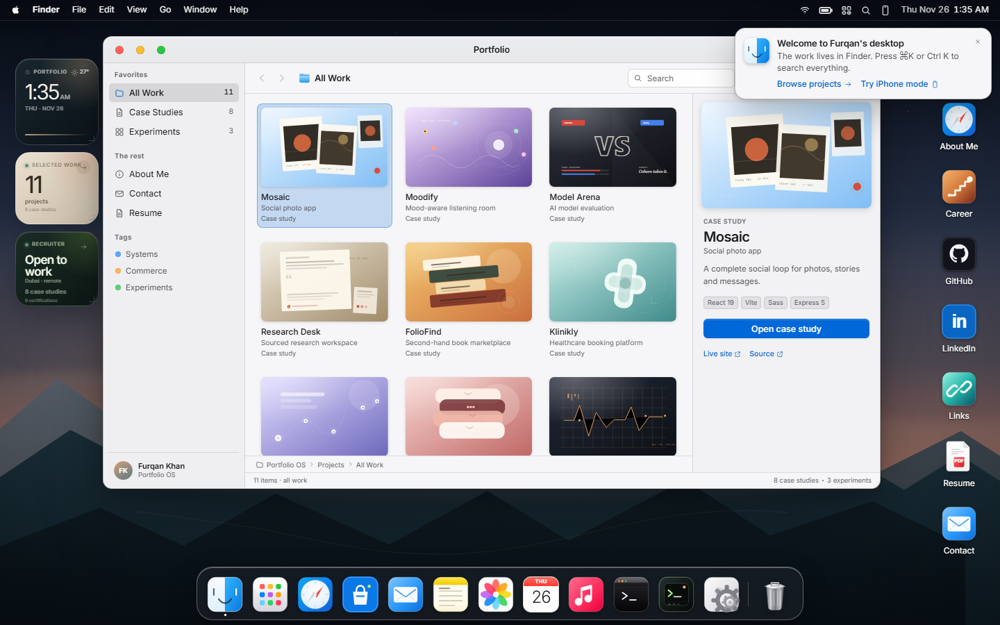
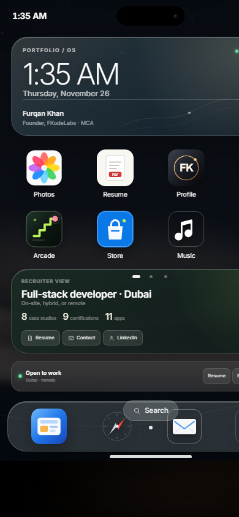

# PortfolioOS

> An interactive macOS and iPhone portfolio, not a screenshot.

[](https://furqankhan.dev)
[](https://furqankhan.dev)
[](LICENSE)

PortfolioOS is an interactive portfolio for Furqan Khan, built as a working macOS desktop and a full iPhone experience rather than a scrolling page. The desktop has a window manager, menu bar, Dock, Spotlight, Launchpad, and a set of applications; the iPhone has its own home screen, lock screen, Dynamic Island, and app suite. It is for recruiters, clients, and developers who want to inspect 11 live projects inside something closer to a real operating system.

This is [Furqan Khan's portfolio](https://furqankhan.dev): the projects, experience, certifications, and contact details are the content of the OS.

**Live:** https://furqankhan.dev · **Source:** https://github.com/fk219/portfolio-os





## What it is

The desktop is not a screenshot. The menu bar opens real menus, the Dock launches applications, windows move and resize, and the portfolio lives inside Finder, Safari, Store, Mail, Notes, Terminal, DevKit, Photos, Calendar, Music, Career, Links, Preview, and System Settings.

The same content has a second surface: an iPhone experience with a framed phone on wide screens, an edge-to-edge home screen on phones, a Dynamic Island, a home indicator, Control Center, a lock screen, and dedicated iOS apps. Music state, appearance, and wallpaper follow the visitor between the two surfaces.

## The portfolio

The 11 projects below are the content of the desktop. Each case study has screenshots, a stack, highlights, and a live link; public repositories are linked where they exist.

| Project | What it is | Live |
|---|---|---|
| PhotoSocial | Social photo app with feeds, stories, messages, and notifications | https://photosocial.furqankhan.dev |
| MoodMusic | Mood-aware listening room with an on-device camera path | https://moodmusic.furqankhan.dev |
| ModelCompare | Two-model arena with a judge, scorecard, and shareable report | https://modelcompare.furqankhan.dev |
| ResearchDesk | Sourced research workspace with numbered citations | https://researchdesk.furqankhan.dev |
| FolioFind | Second-hand book marketplace with a private reading room | https://foliofind.furqankhan.dev |
| Klinikly | Healthcare booking platform with a hospital portal | https://klinikly.furqankhan.dev |
| LearnHub | Learning platform with a course route and progress | https://learnhub.furqankhan.dev |
| Hooked on Cakes | Cake storefront with a separate owner dashboard | https://hookedoncakes.furqankhan.dev |
| PacketAnalyzer | PCAP analysis and DPI-style blocking lab | https://packetanalyzer.furqankhan.dev |
| MeshPay | Offline mesh payments simulation with deferred settlement | https://meshpay.furqankhan.dev |
| VectorSearch | HNSW, KD-tree, and extractive RAG lab | https://vectorsearch.furqankhan.dev |

All source repositories are public except Hooked on Cakes, which stays private until the credentials in its git history are rotated and purged. Every live demo is public.

## The signature idea

The interface is the navigation. Instead of a long page with anchors, the portfolio behaves like an operating system: projects open in windows, the Dock tracks running apps, menus act on the active window, Spotlight searches applications, projects, and actions, and Settings changes propagate across the desktop. The iPhone is not a mobile fallback; it is a second shell over the same data and the same media player.

The metaphor is functional rather than decorative. Content is isolated in typed data modules, while the shell, window manager, app registry, and persistence live in `src/lib`. That separation is why the same project catalogue can drive Finder, Store, Photos, Spotlight, the iPhone Projects app, and the print resume without duplicating the content in five places.

## What is included

### Desktop

- Boot, login, lock, sleep, and shut-down screens.
- A macOS-style menu bar with Apple and application menus, plus File, Edit, View, Go, Window, and Help menus.
- Focus-aware windows with drag, resize, minimize, zoom, close, and stacking.
- A magnifying Dock with running indicators, tooltips, an optional Preview entry, launch bounce, and a compact mobile layout.
- Mission Control: press `F3` or `Ctrl ↑`, use the View menu, or click the Dock tile to see every open window as a card. Click a card to jump back, or use Show desktop and Close all.
- Launchpad with search and an app grid; Spotlight with keyboard navigation across apps, projects, and actions.
- Control Center with Wi-Fi, Bluetooth, Focus, appearance, brightness, wallpaper, and quick system actions.
- Notification Center with a live calendar, Focus control, and dismissible onboarding tips.
- Desktop widgets for the clock, a selected project, and a recruiter snapshot.
- Five original wallpapers, light and dark appearances, and a desktop context menu.

### iPhone

- A scaled iPhone frame on wide screens and a full-screen experience on phones.
- Dynamic Island, home indicator, iOS status bar, lock screen, Control Center, Search, and Notification Center.
- Three swipeable home screens with real, clickable page dots and a smooth page transition. Page one carries the portfolio apps and the smart stack; page two gathers the utility apps (Links, Notes, Clock, Calculator), the portfolio index, direct links, and a live Dubai weather card from Open-Meteo; page three is an App Library with all sixteen apps. Search and the page dots sit in a shared footer above the dock.
- Pull down anywhere across the top edge: the left half opens Notification Center, the right half opens Control Center, on the home screen and inside every app.
- Phone-specific polish: the software Dynamic Island is hidden when nothing is playing, the redundant recruiter strip is removed, and the home footer clears the Dock and safe area.
- Pull-down Control Center from the top-right (or tap the status icons): connectivity, now playing, Focus, brightness and volume, appearance, Mac switch, project shortcuts, and lock. The top-left pull-down opens Notification Center.
- A home-screen smart stack with recruiter view, selected work, and a now-building card, plus a recruiter quick-action strip.
- Lock-screen weather from Open-Meteo and now-playing state from the shared music player.
- Sixteen iOS app entries: Projects, Safari, Contact, Settings, Photos, Resume, Profile, Experience, Arcade, Store, Music, DevKit, Links, Notes, Clock, and Calculator.
- A return to the Mac desktop from the stage header or Control Center.

### Apps

- **Mac:** Finder, Safari, Mail, Notes, Photos, Calendar, Music, Terminal, DevKit, Store, LinkedIn, GitHub, Career, Links, Preview, System Settings, About This Mac, and Trash.
- **Finder:** case-study and experiment filters, search, sort, grid/list views, a preview pane, and full project views.
- **Safari:** start page, address resolution, Marginalia search, embedded sites, recent pages, and a resume shortcut.
- **Store:** editorial collections, project product pages, screenshots, source/live links, a developer profile, and the Arcade.
- **Mail:** validated composer that hands off to the visitor's mail app, with a copy-address fallback.
- **Notes, Photos, Calendar, and Music:** built-in notes with search, checklists, links, and copy; a screenshot/artwork gallery with an in-window viewer; a local event store; and three original 32-second MP3 loops.
- **Terminal:** command history and commands including `help`, `projects`, `open`, `theme`, `wallpaper`, `neofetch`, and `exit`.
- **Career, Links, and Preview:** the professional timeline, education, nine certifications, contact links, and the printable resume.

### Arcade

Two games live inside the Store:

- **Snake:** keyboard and directional controls, a local best score, and speed that increases with length.
- **Bug Hunt:** seven rounds of finding the bug in a code snippet, with explanations, a local best score, and a shareable score card.

### DevKit

- Seven live checks: resume PDF, music library, Open Graph image, project catalogue, GitHub API, weather feed, and live origin.
- Browser telemetry: viewport, DPR, cores, memory, platform, language, timezone, connection, touch, theme, reduced motion, and battery where exposed.
- Recent GitHub commits for this repository, cached for five minutes.
- An in-page JavaScript playground that evaluates expressions with the project and profile data.

### Resume and print

The site includes a print-only resume surface and a downloadable two-page PDF at `public/furqan-khan-resume.pdf`. Printing the page uses a dedicated stylesheet that removes the desktop chrome.

## What works

- Window focus, stacking, drag, resize, minimize, zoom, and close all update the shared window state; the Dock reflects which apps are running.
- Menu commands act on the active window, including close, close all, minimize, zoom, and quit.
- Spotlight and Launchpad support keyboard navigation; Escape closes the active overlay; the documented shortcuts work across the desktop.
- Mission Control tracks every non-minimized window, highlights the active one, and returns focus to the card you click. It reflects the same window state as the Dock and menu bar.
- A phone or small tablet opens in the iPhone experience on a first visit. Choosing Mac or iPhone explicitly, or using `?experience=mac`, overrides that default and is remembered.
- Appearance, wallpaper, Dock size and magnification, brightness, experience mode, and reset controls persist in local storage.
- Music uses one shared HTML audio player, so playback and now-playing state follow the desktop, menu bar, and iPhone.
- The first desktop entry is remembered for the browser session; settings survive a reload.
- The layout has compact modes for phones, small tablets, and narrow windows, including landscape and safe-area handling.
- Windows, forms, menus, and launchers have keyboard paths, focus indicators are visible, and reduced-motion preferences are respected.
- A no-JavaScript fallback lists the selected work, all projects, and contact details.

## Tech stack in detail

| Layer | Technology | What it does here |
|---|---|---|
| Framework | Next.js 16.4.6, App Router | Single portfolio route, metadata, icon, Open Graph image, and production build |
| UI | React 19.3.1 | Stateful desktop and iPhone shells with shared context |
| Language | TypeScript 5.9.3 | Typed projects, career data, app registry, windows, and settings |
| Styling | Hand-written CSS in `src/app/globals.css` and `src/styles/` | macOS/iOS chrome, compact layouts, appearance themes, and print styles |
| State | React context, `useReducer`, and hooks | Boot phase, windows, settings, overlays, and local persistence |
| Window manager | `src/lib/window-manager.ts` and `WindowFrame` | Focus order, stacking, drag, resize, minimize, zoom, and close |
| Content | Typed modules in `src/data/` | 11 projects, profile, career, music, wallpapers, and Bug Hunt rounds |
| Media | HTML audio plus a shared provider | Three local MP3 loops and now-playing state across surfaces |
| Integrations | GitHub REST API, Open-Meteo | GitHub app, DevKit commit history, lock-screen weather |
| Delivery | Vercel, GitHub Actions | Production hosting and the build check; no server or database |

## Performance and motion

- Every Mac app and every iPhone app loads as its own client chunk. The shell, wallpaper, icons, and data stay in the initial bundle; opening an app fetches only that app's code.
- Dock and Launchpad items prefetch their chunk on hover, focus, or pointer-down, and iOS app icons prefetch on the same intent. A lightweight app-loading state covers the gap without shifting layout.
- The Dubai weather request starts only when the Utilities page or lock screen is opened, not on the first home-screen paint.
- The project stack, project gallery, and later iOS project cards use `content-visibility: auto` with intrinsic placeholder sizes, so offscreen work is skipped without moving the scrollbar.
- Window and app transitions animate transform and opacity with spring easing. Project cards stagger in, and reduced-motion users get the final state without spatial animation.
- The wallpaper drift and equalizer animations pause when the document is hidden; the wallpaper is static on phones. Window backdrop blur is dropped while dragging or resizing to keep interaction smooth.

## Architecture

`src/app/page.tsx` renders `ExperienceShell`, which chooses the desktop or the iPhone from persisted settings. `OSProvider` owns the boot phase, open windows, appearance, wallpaper, overlays, and settings persistence; `MediaPlayerProvider` owns playback. The desktop composes the OS chrome around `WindowContent`. The iPhone has its own shell and app suite over the same data modules.

```text
src/app/page.tsx
  |-- ExperienceShell
  |     |-- Desktop (default)
  |     |     |-- Wallpaper, icons, widgets
  |     |     |-- MenuBar, Dock, WindowFrame / WindowContent
  |     |     `-- Spotlight, Launchpad, Control Center, Notification Center
  |     `-- IOSExperience
  |           |-- Home screen, chrome, status bar, Dynamic Island
  |           |-- 16-app iOS suite
  |           `-- Lock screen, Control Center, Search, notifications
  |-- ResumeSheet (print only)
  `-- <noscript> portfolio fallback
```

```text
src/
  app/
    globals.css              Base tokens, controls, print styles
    icon.svg                 Application icon
    layout.tsx               Metadata, font, OS and media providers
    opengraph-image.tsx      Generated social image
    page.tsx                 Desktop entry, print resume, no-JS fallback
  components/
    apps/                    Mac apps, project views, resume, DevKit subviews
    arcade/                  BugHunt.tsx, SnakeGame.tsx
    icons/                   AppIcon, FileIcon, IconGradients, SystemIcon
    ios/                     iPhone shell, chrome, screens, 16 iOS apps
    os/                      Desktop, MenuBar, Dock, windows, widgets, overlays
  data/
    bug-hunt.ts              Seven Bug Hunt rounds and explanations
    career.ts                Timeline, education, nine certifications
    music.ts                 Three track definitions
    profile.ts               Identity, summary, skills, links
    projects.ts              11 project case studies
    wallpapers.ts            Five wallpaper entries
  lib/
    apps.ts                  App registry, Dock entries, window bounds
    clipboard.ts             Clipboard helpers
    devkit.ts                Checks, commits, device telemetry, playground
    github-profile.ts        GitHub profile and repository cache
    hooks.ts                 Shared hooks, Escape and focus trap
    media-player.tsx         Shared HTML audio player
    os-context.tsx           OS state, windows, overlays, persistence
    types.ts                 Shared OS and content types
    weather.ts               Dubai weather cache
    web-url.ts               Safari address resolution
    window-manager.ts        Window reducer and focus logic
  styles/                    os, apps, overlays, ios, career, devkit, store, social, icons
public/
  music/                     Three MP3 loops
  projects/                  Screenshots of the 11 live projects
  furqan-khan-resume.pdf     Two-page resume
docs/
  portfolio-desktop.png      Desktop screenshot
  portfolio-iphone.png       iPhone screenshot
```

## Run it locally

Prerequisites: Node 22 and npm. There is no database or API to start. `.nvmrc` and CI pin Node 22.

```bash
npm install
npm run dev
```

Open `http://localhost:3000`.

For a production check:

```bash
npm run build
npm start
```

Create `.env.local` from `.env.example` if you need to set the canonical URL.

| Name | Required | Purpose |
|---|---|---|
| `NEXT_PUBLIC_SITE_URL` | No in development; recommended in production | Canonical site URL used by metadata, Open Graph, and canonical tags. |
| `VERCEL_URL` | No | Injected by Vercel; used as the metadata fallback when `NEXT_PUBLIC_SITE_URL` is not set. |

**Demo access:** there is no login. Press **Enter desktop** on the lock screen, or add `?skipIntro=1` to skip the startup sequence. Add `?experience=ios` to open directly in the iPhone experience. Seeded demo paths and shared demo accounts for the 11 projects are documented in [DEMO_ACCESS.md](DEMO_ACCESS.md); projects with authentication include a one-click demo entry.

## API

PortfolioOS has no API routes, server actions, database, or authentication. Next.js renders the page, and all interactive state stays in the browser. Its data fetches are client-side reads from public services:

| Method | Endpoint | Purpose |
|---|---|---|
| `GET` | `https://api.github.com/users/fk219` | GitHub profile data for the GitHub app |
| `GET` | `https://api.github.com/users/fk219/repos?per_page=100&sort=pushed` | Public repository list |
| `GET` | `https://api.github.com/repos/fk219/portfolio-os` | Repository metadata for DevKit |
| `GET` | `https://api.github.com/repos/fk219/portfolio-os/commits?per_page=3` | Recent commits for DevKit |
| `GET` | `https://api.open-meteo.com/v1/forecast?latitude=25.2048&longitude=55.2708&current=temperature_2m,weather_code&timezone=Asia%2FDubai` | Dubai weather for the lock screen and DevKit |

DevKit also sends `HEAD` requests to local assets: `/furqan-khan-resume.pdf`, the three files under `/music/`, `/opengraph-image`, and the site origin. Safari loads external sites in an iframe when a visitor opens one. The GitHub and weather requests send no credentials; GitHub's unauthenticated rate limit applies.

## Tests

There is no automated test script in `package.json`. The scripted check is the production build:

```bash
npm run build
```

The build runs TypeScript checks and generates the route and social image; the application icon is a static SVG. GitHub Actions runs `npm ci` and `npm run build` on Node 22 for pushes to `main` and pull requests.

The repository's documented manual QA pass covered the desktop at 1440×900, the iPhone at 390×844, 320×568, and 844×390 landscape, plus Safari, Career, Links, Search, Control Center, the lock screen, both home pages, and Mission Control. The axe pass reported zero WCAG A/AA violations; some contrast checks over wallpaper-backed glass surfaces remained inconclusive.

## Deployment

- **Hosting:** Vercel serves the production build at https://furqankhan.dev.
- **Environment:** set `NEXT_PUBLIC_SITE_URL=https://furqankhan.dev` in production. On Vercel, `VERCEL_URL` is the fallback for preview deployments. There are no secrets, database URLs, or server-only variables.
- **Runtime:** Next.js 16.4.6 and React 19.3.1, with Node 22 pinned in `.nvmrc` and CI. The app has no API routes or server state.
- **CI:** `.github/workflows/ci.yml` installs with `npm ci` and runs `npm run build` on Node 22, with the production site URL.

## Limits and notes

- Mail is a front-end composer. It opens the visitor's mail app with a prefilled message; the website sends nothing.
- Calendar events, settings, Bug Hunt and Snake best scores, and the dismissed-notification list are stored in the browser.
- There is no server, database, or user account, so nothing syncs across devices.
- Project links point to their existing live deployments and repositories. All source repositories are public except Hooked on Cakes, whose history still needs cleaning.
- Safari embeds sites in an iframe. Sites that block framing will not render inside the window; use the open-in-new-tab path for those.
- Weather and GitHub data depend on public APIs, network access, and GitHub's unauthenticated rate limit. DevKit shows a failed check when a service is unavailable.
- The DevKit playground evaluates expressions in the page with project data. It is a convenience tool, not a security sandbox.
- Music is three original 32-second loops under `public/music/`, not a full streaming catalogue.
- Screenshots under `public/projects/` were captured from the projects' live deployments.
- `public/furqan-khan-resume.pdf` is generated from the print-only resume surface. Regenerate it after changing `career.ts` or `profile.ts`.
- Experience and certification content reflects the public LinkedIn profile at the time of the build and may need refreshing.
- This is an independent portfolio experience and is not affiliated with Apple Inc. Wallpapers and icons are original SVG work, not Apple assets.

## License

MIT. See [LICENSE](LICENSE).
